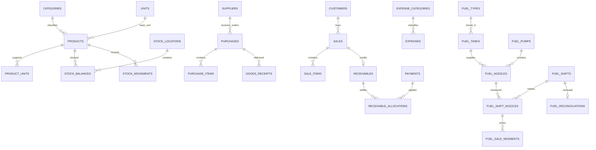

# SmartStock Database Guide — Khmer

## ERD overview (logical)

## Key domains
- Identity & RBAC: `users`, `roles`, `permissions`, `user_roles`, `role_permissions`, `auth_sessions`, `audit_logs`
- Master data: `categories`, `brands`, `units`, `products`, `product_units`, `product_prices`, `product_barcodes`
- Inventory: `stock_locations`, `stock_balances`, `stock_batches`, `stock_movements`, `product_costs`, `inventory_cost_entries`, stock transfers and adjustments
- Purchasing: `suppliers`, `purchases`, `purchase_items`, `goods_receipts`, `goods_receipt_items`, `payables`, `payable_allocations`
- Sales & credit: `customers`, `sales`, `sale_items`, `sale_returns`, `receivables`, `receivable_allocations`, `payments`
- Expenses: `expense_categories`, `expenses`, `expense_payments`, `expense_budgets`, `recurring_expense_rules`
- Fuel: `fuel_types`, `fuel_tanks`, `fuel_pumps`, `fuel_nozzles`, `fuel_receipts`, `fuel_shifts`, `fuel_shift_nozzles`, `fuel_sale_segments`, `fuel_shift_settlements`, `fuel_reconciliations`, `fuel_tank_measurements`
- Smart & admin: `reorder_rules`, `notifications`, `approval_requests`, `system_settings`

## Moving Weighted Average Cost
At purchase receipt, with existing stock quantity Q, value V, and received q at landed unit cost c: new Q = Q+q, new V = V+q*c, average = new V/new Q. **សម្រាប់ប្រតិបត្តិការលក់**: COGS = q_sold*average before sale; deduct q_sold from Q and COGS from V. កុំគណនាចំណេញដោយយក Sales ដក Total Purchase Payments។

## Invariants
1. Base Unit: all stock ledger records use base quantity. Purchase/sale units are snapshots at transaction time.
2. Inventory: every confirmed stock movement has deterministic `movement_key` unique; reverse via new movement, not editing history.
3. Location transfer: two signed movements, total quantity unchanged, no revenue, no COGS.
4. Financial: revenue from confirmed sale, payment cash flow separate; customer loan settlement must not create another sale.
5. Fuel: physical fuel tanks must map correctly to nozzle. Shift meter segments sum to total sold; credit/bank transactions are subset of total sales, not additional fuel volume.
6. All postings use transaction; lock `product_costs` and relevant `stock_balances` rows in stable order; ensure no negative balances.
7. `stock_balances` and `product_costs` are *materialized current state*, ledger entries are traceable source; reconciliation tasks can find inconsistencies.
8. On returns, carry original cost and sales references; do not automatically re-price old returns using today's average.
9. `approval_requests` polymorphic entity reference must be validated by PHP; DB cannot enforce generic entity FK.
10. `fuel_tanks` capacity and contents require additional calibrated physical measurement controls; initial configuration is still unknown.

## Dashboard queries (conceptual)
- Revenue: sum confirmed sale items net of returns + confirmed fuel shift sales *only if not already posted as sales*.
- COGS: inventory cost entries for confirmed outgoing sale/fuel, net of reversals.
- Operating expenses: confirmed expenses classified `operating`.
- Gross profit = net revenue - COGS; operating profit = gross profit - operating expenses.
- Stock summary: sum `stock_balances.qty_base` by product across all locations; exclude damaged location from sellable stock.
- Customer outstanding: original receivables - verified allocations - eligible credits/returns.
- Fuel shift anomalies: confirmed or pending `fuel_reconciliations` with nonzero variance.

## Development limitations/next migration
- Scope is broad: 63 interconnected tables form a draft foundation, not all UI/workflows or completed accounting implementation.
- Fuel receipt posting needs one consistent integration into common `stock_movements` and `inventory_cost_entries`.
- Full tax accounting, double-entry general ledger, tank temperature compensation, regulatory reports, multi-branch, and automated bank verification are intentionally out of scope for v1.
- Stock-batch and reconciliation validation live in application service logic and tests.
- Test actual MySQL 8 behavior, FK type compatibility, request/rollback correctness, time-zone treatment, report totals and indices before deploying.
